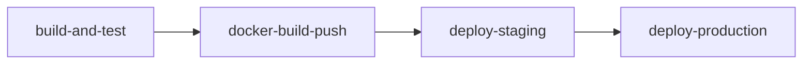

# Projeto - Cidades ESG Inteligentes

> API REST (**Sustentabilidade API**) para o eixo ambiental do tema **Cidades ESG Inteligentes**,
> permitindo que empresas registrem emissões de carbono e gerenciem ações de redução de impacto
> ambiental, com autenticação JWT e isolamento de dados entre empresas.

Este README cobre a execução local, o pipeline de CI/CD, a containerização e as tecnologias
utilizadas. Para as regras de negócio e a documentação completa dos endpoints da API, veja a seção
[Documentação da API](#-documentação-da-api) ao final deste arquivo.

---

## Como executar localmente com Docker

### Pré-requisitos

- [Docker](https://docs.docker.com/get-docker/) 24+
- [Docker Compose](https://docs.docker.com/compose/) v2 (plugin `docker compose`)

### Passo a passo

1. **Clone o repositório** e entre na pasta do projeto:

   ```bash
   git clone <url-do-repositorio>
   cd sustentabilidade
   ```

2. **Crie o arquivo de variáveis de ambiente** a partir do exemplo:

   ```bash
   cp .env.example .env
   ```

   Ajuste as senhas em `.env` se desejar (os valores padrão já funcionam para uso local/demonstração).

3. **Suba a stack completa** (aplicação + banco Oracle) com Docker Compose:

   ```bash
   docker compose up -d --build
   ```

   Isso vai:
   - Buildar a imagem da API a partir do `Dockerfile` (multi-stage: compila com Maven e gera uma
     imagem final enxuta apenas com o JRE).
   - Subir o banco de dados Oracle (`gvenzl/oracle-free`), aguardando ele ficar saudável
     (`healthcheck`) antes de iniciar a aplicação (`depends_on: condition: service_healthy`).
   - Executar automaticamente as migrations do Flyway na primeira inicialização.

4. **Acompanhe os logs** (opcional):

   ```bash
   docker compose logs -f app
   ```

5. **Verifique se a aplicação está no ar:**

   ```bash
   curl http://localhost:8080/actuator/health
   # {"status":"UP"}
   ```

6. **Teste um fluxo real da API:**

   ```bash
   # Registrar uma empresa
   curl -X POST http://localhost:8080/auth/register \
     -H "Content-Type: application/json" \
     -d '{"nomeEmpresa":"Eco Agro Industrial","nomeCidade":"Ribeirao Preto","siglaEstado":"SP","email":"ecoagro@email.com","senha":"123456"}'

   # Login
   curl -X POST http://localhost:8080/auth/login \
     -H "Content-Type: application/json" \
     -d '{"email":"ecoagro@email.com","senha":"123456"}'
   ```

7. **Para derrubar o ambiente:**

   ```bash
   docker compose down -v
   ```

### Executando sem Docker (desenvolvimento local)

Também é possível rodar a aplicação diretamente com Maven, apontando para um Oracle já existente
(por exemplo, o Oracle da FIAP usado como padrão em `application.properties`):

```bash
mvn spring-boot:run
```

As variáveis `SPRING_DATASOURCE_URL`, `SPRING_DATASOURCE_USERNAME`, `SPRING_DATASOURCE_PASSWORD` e
`JWT_SECRET` podem ser exportadas no shell para sobrescrever os valores padrão sem alterar o código.

---

## Pipeline CI/CD

**Ferramenta utilizada:** [GitHub Actions](https://docs.github.com/actions), com o workflow
definido em [`.github/workflows/ci-cd.yml`](.github/workflows/ci-cd.yml).

O pipeline é disparado em `push`/`pull_request` para as branches `main` e `develop`, além de poder
ser disparado manualmente (`workflow_dispatch`). Ele é dividido em 4 jobs encadeados:



### 1) `build-and-test` — Build e testes automatizados

- Sobe um **serviço Oracle** (`gvenzl/oracle-free`) como _service container_ do próprio job,
  simulando o banco de dados real usado pela aplicação (necessário pois as migrations do Flyway
  usam sintaxe específica do Oracle).
- Configura o **JDK 21 (Temurin)** com cache de dependências Maven.
- `mvn clean compile` → etapa de **build**.
- `mvn test` → etapa de **testes automatizados**, apontando para o Oracle do service container.
- Publica o relatório de testes (Surefire) e o `.jar` gerado como artefatos do workflow.

### 2) `docker-build-push` — Build e publicação da imagem Docker

- Builda a imagem Docker (multi-stage, descrita abaixo) usando Docker Buildx, com cache via GitHub
  Actions (`cache-from`/`cache-to: type=gha`).
- Publica a imagem no **GitHub Container Registry (GHCR)** com duas tags: `sha-<commit>` (imutável,
  rastreável a cada execução) e `latest`.
- Segue o princípio **"build once, deploy many"**: a mesma imagem publicada aqui é a que será
  reaproveitada (via `docker pull`) nos deploys de staging e produção — nunca se builda uma imagem
  diferente para cada ambiente.

### 3) `deploy-staging` — Deploy automatizado em Staging

- Usa o **Environment** `staging` do GitHub Actions (pode receber regras de proteção configuráveis
  em _Settings → Environments_).
- Gera um arquivo `.env` de staging e faz `docker compose pull` + `docker compose up -d`, subindo a
  aplicação (perfil `staging`, porta `8081`) junto com o banco Oracle.
- Aguarda a aplicação ficar saudável e executa um **smoke test** via `/actuator/health`.
- Publica os logs do ambiente como evidência e derruba a stack ao final.

### 4) `deploy-production` — Deploy automatizado em Produção

- Só executa em `push` para a branch `main` e depois que o `deploy-staging` for concluído com
  sucesso (promoção progressiva: staging → produção).
- Usa o **Environment** `production` — em um cenário real, adicione _required reviewers_ nesse
  Environment (GitHub Settings → Environments → production → Required reviewers) para exigir
  aprovação manual antes do deploy em produção.
- Mesmo fluxo do staging (pull da imagem publicada, `docker compose up -d`, smoke test via
  `/actuator/health`), porém com perfil `production` e porta `8080`.

> **Nota sobre o "ambiente":** como o projeto não depende de um servidor remoto fornecido, os
> ambientes de staging/produção são provisionados automaticamente dentro do próprio runner do
> GitHub Actions via Docker Compose, o que permite validar de forma real (build da imagem, subida
> do banco, migrations, smoke test HTTP) um pipeline de deploy completo. Em um cenário real com uma
> VM/cloud disponível, bastaria trocar os passos de `docker compose up` por um `ssh` para o host de
> destino (ou usar uma action de deploy do provedor de nuvem escolhido), mantendo a mesma imagem
> publicada no GHCR.

### Segredos/variáveis usados pelo pipeline

O workflow funciona _out-of-the-box_ com valores padrão (não sensíveis) caso os secrets não sejam
configurados, mas em um repositório real recomenda-se cadastrar em
**Settings → Secrets and variables → Actions**:

| Secret            | Descrição                                |
| ----------------- | ---------------------------------------- |
| `ORACLE_PASSWORD` | Senha do usuário administrador do Oracle |
| `DB_USER`         | Usuário de aplicação criado no Oracle    |
| `DB_PASSWORD`     | Senha do usuário de aplicação            |
| `JWT_SECRET`      | Chave usada para assinar os tokens JWT   |

---

## Containerização

### Dockerfile

```dockerfile
# syntax=docker/dockerfile:1

# ======================================================================
# Etapa 1 - Build: compila o projeto Maven e gera o .jar executavel
# ======================================================================
FROM maven:3.9.9-eclipse-temurin-21 AS build
WORKDIR /app

# Copia primeiro o pom.xml para aproveitar o cache de dependencias do Docker.
# Enquanto o pom.xml nao mudar, essa camada fica em cache entre builds.
COPY pom.xml .
RUN mvn -B dependency:go-offline

# Copia o codigo-fonte e empacota a aplicacao (os testes ja rodam na etapa
# de "testes" do pipeline de CI, por isso sao pulados aqui para acelerar
# o build da imagem).
COPY src ./src
RUN mvn -B clean package -DskipTests

# ======================================================================
# Etapa 2 - Runtime: imagem final, enxuta, somente com o JRE e o .jar
# ======================================================================
FROM eclipse-temurin:21-jre-alpine AS runtime
WORKDIR /app

# Usuario nao-root por boas praticas de seguranca em containers
RUN addgroup -S spring && adduser -S spring -G spring

COPY --from=build /app/target/sustentabilidade-0.0.1-SNAPSHOT.jar app.jar

RUN chown -R spring:spring /app
USER spring:spring

ENV SERVER_PORT=8080
EXPOSE 8080

# Healthcheck usado pelo Docker/Compose para saber quando a aplicacao
# esta pronta (consome o endpoint do Spring Boot Actuator)
HEALTHCHECK --interval=15s --timeout=5s --start-period=40s --retries=8 \
    CMD wget -qO- http://localhost:8080/actuator/health | grep -q '"status":"UP"' || exit 1

ENTRYPOINT ["java", "-jar", "/app/app.jar"]
```

**Estratégias adotadas:**

- **Multi-stage build**: separa a etapa de _build_ (com Maven + JDK completo, ~500MB+) da etapa de
  _runtime_ (apenas JRE + Alpine, imagem final bem menor e com menos superfície de ataque).
- **Cache de dependências**: o `pom.xml` é copiado e `mvn dependency:go-offline` é executado antes
  de copiar o código-fonte, para que alterações no código não invalidem o cache de dependências.
- **Usuário não-root**: a aplicação roda com o usuário `spring`, nunca como `root`.
- **Healthcheck nativo**: o próprio Docker/Compose sabe quando a aplicação está pronta, usado tanto
  no `depends_on: condition: service_healthy` do Compose quanto no smoke test do pipeline de CI/CD.
- **Configuração 100% via variáveis de ambiente**: nenhuma credencial fica hard-coded na imagem.

### Orquestração (`docker-compose.yml`)

```yaml
services:
   db:
      image: gvenzl/oracle-free:23-slim-faststart
      environment:
         ORACLE_PASSWORD: ${ORACLE_PASSWORD:-OraclePass_123}
         APP_USER: ${DB_USER:-sustentabilidade_app}
         APP_USER_PASSWORD: ${DB_PASSWORD:-AppPass_123}
      volumes:
         - oracle-data:/opt/oracle/oradata
      networks:
         - sustentabilidade-net
      healthcheck:
         test: ["CMD", "healthcheck.sh"]
         # ...

   app:
      build: { context: ., dockerfile: Dockerfile }
      image: ${APP_IMAGE:-sustentabilidade-api:local}
      depends_on:
         db:
            condition: service_healthy
      environment:
         SPRING_PROFILES_ACTIVE: ${SPRING_PROFILES_ACTIVE:-staging}
         SPRING_DATASOURCE_URL: jdbc:oracle:thin:@db:1521/FREEPDB1
         SPRING_DATASOURCE_USERNAME: ${DB_USER:-sustentabilidade_app}
         SPRING_DATASOURCE_PASSWORD: ${DB_PASSWORD:-AppPass_123}
         JWT_SECRET: ${JWT_SECRET:-sustentabilidade-api-secret}
      ports:
         - "${APP_PORT:-8080}:8080"
      networks:
         - sustentabilidade-net

volumes:
   oracle-data:

networks:
   sustentabilidade-net:
      driver: bridge
```

(arquivo completo em [`docker-compose.yml`](docker-compose.yml))

- **Serviços**: `app` (Spring Boot) e `db` (Oracle Database Free, via imagem `gvenzl/oracle-free`,
  distribuição gratuita e open-source do Oracle Database usada amplamente para dev/test).
- **Volumes**: `oracle-data` persiste os dados do banco entre reinicializações do container.
- **Variáveis de ambiente**: todas as credenciais e configurações (porta, perfil Spring, segredo
  JWT, credenciais do banco) são injetadas via `.env` (veja [`.env.example`](.env.example)),
  nunca hard-coded.
- **Rede**: `sustentabilidade-net` (bridge dedicada) isola a comunicação entre `app` e `db`; a
  aplicação acessa o banco pelo nome do serviço (`db`), sem expor a rede interna além do necessário.
- **Dependência ordenada**: `depends_on: condition: service_healthy` garante que a aplicação só
  inicia depois que o Oracle estiver realmente pronto para aceitar conexões.

---

## Prints do funcionamento

As evidências de execução (status dos containers, healthcheck e smoke test da API) ficam na pasta
[`docs/evidencias`](docs/evidencias):

- [`01-docker-compose-ps.txt`](docs/evidencias/01-docker-compose-ps.txt) — status dos containers
  (`app` e `db`) rodando e saudáveis (`healthy`) localmente via `docker compose`.
- [`02-healthcheck-status.txt`](docs/evidencias/02-healthcheck-status.txt) — saída do
  `docker inspect` confirmando `healthy` para ambos os containers.
- [`03-app-logs.txt`](docs/evidencias/03-app-logs.txt) — logs da aplicação subindo, aplicando as
  migrations do Flyway e iniciando o Tomcat embutido.
- [`04-smoke-test-api.txt`](docs/evidencias/04-smoke-test-api.txt) — chamadas reais de
  `/actuator/health`, `/auth/register` e `/auth/login` com sucesso.

As execuções do pipeline (build, testes, deploy em staging e produção) ficam disponíveis na aba
**Actions** do repositório no GitHub, em cada `push`/`pull_request`:

```
https://github.com/<usuario>/<repositorio>/actions
```

> Adicione aqui prints (`.png`) da aba Actions mostrando os 4 jobs concluídos com sucesso, e dos
> _environments_ `staging`/`production` (Settings → Environments) após o primeiro deploy.

---

## Tecnologias utilizadas

**Aplicação**

- Java 21
- Spring Boot 3.5 (Web, Data JPA, Security, Validation, Actuator, DevTools)
- JWT (`com.auth0:java-jwt`)
- Oracle Database (JDBC — `ojdbc11`)
- Flyway (migrations de banco)
- Lombok
- Maven

**DevOps / Infraestrutura**

- Docker (multi-stage build)
- Docker Compose (orquestração app + banco)
- GitHub Actions (pipeline de CI/CD)
- GitHub Container Registry — GHCR (registro de imagens)
- `gvenzl/oracle-free` (imagem Docker gratuita do Oracle Database, usada em dev/test/CI)

---

## Checklist de entrega

| Item                                                  | OK  |
| ----------------------------------------------------- | :-: |
| Projeto compactado em `.ZIP` com estrutura organizada |  ☐  |
| Dockerfile funcional                                  |  ☑  |
| `docker-compose.yml` ou arquivos Kubernetes           |  ☑  |
| Pipeline com etapas de build, teste e deploy          |  ☑  |
| README.md com instruções e prints                     |  ☑  |
| Documentação técnica com evidências (PDF ou PPT)      |  ☑  |
| Deploy realizado nos ambientes staging e produção     |  ☑  |

> O item de compactação em `.zip` deve ser marcado após a geração do arquivo final para envio.

---

## Documentação da API

A documentação completa das regras de negócio, autenticação, endpoints e exemplos de
requisição/resposta está em [`docs/api.md`](docs/api.md).
